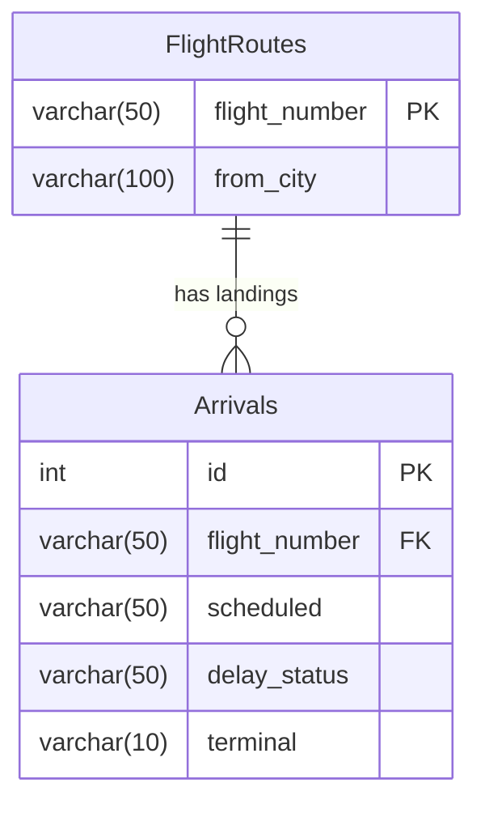

# Flight Arrivals Management System (`JDBC_FlightManager`)

**Course:** Software Engineering Methods (Academic Year 2026–2027)  
**Institution:** Braude College of Engineering | Department of Software Engineering  
**Database Engine:** MySQL 8.0+ | **Language:** Java 25 LTS (JDBC)

---

## 1. Project Description
A Data Access Layer (DAL) for an airport flight-arrivals system. Raw landing data (`arrived_flights.csv`, 299 rows) is imported into MySQL as a flat table `rawflights`, then normalized with an AI-generated migration script into two Third Normal Form tables, `FlightRoutes` and `Arrivals`. Java classes access the database through JDBC:

* `FlightManagerBase` – prints the joined arrivals board (INNER JOIN, 299 rows).
* `SimpleFlightUpdater` – updates the delay status of flight LX354 (first written with a vulnerable `Statement`, later refactored to a `PreparedStatement`).
* `AdvancedFlightDispatcher` – batched update (`addBatch` / `executeBatch`) of several arrival IDs with one `PreparedStatement`.
* `FlightViewer` – shows the arrivals of a chosen terminal, sorted by scheduled time, using a parameterized query.

A live SQL Injection attack (`Landed' #`) was executed against the vulnerable version, corrupting all 299 rows, and then neutralized by refactoring to `PreparedStatement`.

---

## 2. Engineering Team Details (Single-Workstation Driver–Navigator)

| Role | Full Name |
| :--- | :--- |
| **Student A** | Maor Dalal |
| **Student B** | Neta Baron |

* **Group Number:** `G08`
* **GitHub Repository URL:** https://github.com/MaorDalal/JDBC_FlightManager

---

## 3. Technology Stack
* **Runtime & JDK:** BellSoft Liberica Full JDK 25 LTS
* **Database Server:** MySQL Server 8.0.46 (`FlightDB` schema)
* **JDBC Driver:** MySQL Connector/J 9.5.0 (`mysql-connector-j-9.5.0.jar`)
* **IDE & Database Tooling:** IntelliJ IDEA Ultimate (built-in Database console & SQL Generator)
* **AI Assistant:** AI coding assistant used for SQL and Java generation (in place of LM Studio / Qwen2.5-Coder)
* **Version Control:** Git & GitHub

---

## 4. Database Normalization (3NF) & Functional Dependencies ($F$)

### 4.1 Functional Dependencies ($F$) in `rawflights`
Table: `rawflights(scheduled, flight, fromC, delay, terminal)`

* $\text{flight} \rightarrow \text{fromC}$ — a flight number determines its departure city.
* A landing event (a specific flight on a specific schedule) determines its `delay` and `terminal`. Because the same flight can land on several dates/schedules, `flight` alone is not a key of the landing row.

### 4.2 Why `rawflights` Violated 3NF
`fromC` depends on `flight`, which is only part of what identifies a landing row, so the departure city is stored again for every landing of the same flight (redundancy). This causes:

* **Update anomaly** – changing a flight's departure city requires updating every row of that flight; missing one leaves inconsistent data.
* **Insertion anomaly** – a new route (flight + city) cannot be recorded until the flight actually has a landing row.
* **Deletion anomaly** – deleting the last landing of a flight also deletes the knowledge of its departure city.

### 4.3 Decomposed 3NF Relational Schema
* **`FlightRoutes`** (`flight_number` VARCHAR(50) **PK**, `from_city` VARCHAR(100) NOT NULL) – holds $\text{flight} \rightarrow \text{fromC}$ once per flight.
* **`Arrivals`** (`id` INT AUTO_INCREMENT **PK**, `flight_number` VARCHAR(50) NOT NULL **FK → FlightRoutes(flight_number) ON DELETE CASCADE**, `scheduled` VARCHAR(50), `delay_status` VARCHAR(50), `terminal` VARCHAR(10)) – one row per landing event.

Every non-key attribute now depends only on the key of its own table, so both tables are in 3NF. Migration result: 299 routes, 299 arrivals, `rawflights` dropped.

---

## 5. Independent AI Prompt (Part 4 – `FlightViewer.java`)

```text
Write a Java class called FlightViewer with a main method

 ask the user for the MySQL root password using a Scanner, and connect to the FlightDB

database with DriverManager using this url link
"jdbc:mysql://localhost:3306/FlightDB?allowLoadLocalInfile=true&allowPublicKeyRetrieval=true&serverTimezone=Asia/Jerusalem&useSSL=false"
and the user "root". Use try-with-resources for the Connection, the PreparedStatement and the ResultSet.

 check with the user which terminal they want to see (the valid terminals are 2, 3, 4 and 5).

Show all the arrivals for that terminal by joining the Arrivals table with the FlightRoutes table
(INNER JOIN on flight_number). Use a PreparedStatement with a ? placeholder:
WHERE Arrivals.terminal = ? and sort the results with ORDER BY Arrivals.scheduled ASC.
Since terminal is a VARCHAR(10) column, bind the value with pstmt.setString(1, terminal).
Don't build the SQL by concatenating the user's input.

Print the results as a neat table with the columns ID, Flight, From, Scheduled, Status and Terminal,
and at the end print how many flights were found for that terminal.
```

---

## 6. Entity Relationship Diagram (ERD)



---

## 7. Security Audit Summary (Part 5 – SQL Injection Mitigation)
* **Attack Payload Tested:** `Landed' #`
* **Vulnerability Analysis (`Statement`):** The original `SimpleFlightUpdater` concatenated user input into the SQL text. The payload produced `UPDATE Arrivals SET delay_status = 'Landed' #' WHERE flight_number = 'LX354'`. The `'` closed the string literal early and `#` started a MySQL comment, so the `WHERE` clause was ignored and all 299 rows were overwritten (`Rows affected: 299`).
* **Remediation (`PreparedStatement`):** The class now uses `UPDATE Arrivals SET delay_status = ? WHERE flight_number = ?`. The query is compiled before the input is attached, and `setString` sends the input strictly as data, so quotes and `#` cannot change the command. Re-running the same payload updated only LX354, storing the literal text `Landed' #` (`Rows affected: 1`), and the other 298 rows stayed intact.

---

## 8. License
Distributed under the **Braude College Academic License** (Software Engineering Methods, 2026–2027).
